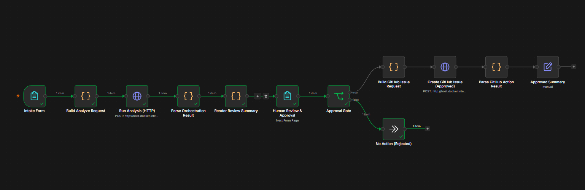
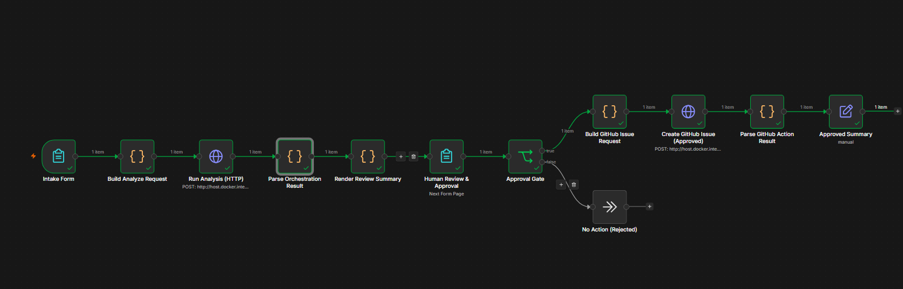

# Product Feedback Agent

Product Feedback Agent turns fragmented customer feedback (support tickets,
survey responses, app-store reviews, interview notes) into a small number of
evidence-backed product opportunities, reviewed by a second AI pass and
gated behind explicit human approval before anything external happens.

It is a solo MVP built end-to-end (Python + Gemini + local vector retrieval
+ n8n + GitHub) with a specific point of view: **an AI system that
recommends is more trustworthy, and more useful, than one that decides.**

## 1. The Product Problem

Product teams drown in feedback and starve for evidence. Feedback arrives
scattered across tickets, surveys, reviews, and interviews; turning it into
a small number of well-supported opportunities is slow, manual, and easy to
get wrong -- either by missing a real signal buried in the noise, or by
overweighting the loudest complaint instead of the best-evidenced one.

## 2. Target User

A product manager or product-ops lead at a small/mid-size team who
regularly has more raw feedback than time to synthesize it, and wants a
defensible starting point for "what should we look at next" -- not a tool
that ships decisions on their behalf.

## 3. What Product Feedback Agent Does

Given a feedback file (CSV/JSON) and optional product-context documents
(strategy/roadmap Markdown), it produces **exactly three** evidence-backed
opportunity cards, each with:

- a problem statement and underlying need (distinguished from any specific
  requested solution)
- affected customer segments, supported by the feedback's own metadata
- exact, verbatim quoted evidence, cited by feedback ID
- a transparent, deterministically computed score (evidence strength,
  severity, strategic alignment, segment breadth, confidence)
- evidence gaps and discovery questions
- a recommended next step (research/discovery when evidence is thin, not a
  forced build decision)

A second AI pass (the critic) reviews the first draft for evidence support,
duplicate opportunities, ignored contradictions, and roadmap overreach, and
can trigger exactly one bounded revision. A human then reviews the result
and is the only one who can authorize creating a real GitHub issue from it.

## 4. Why This Matters

The interesting engineering problem here isn't "call an LLM" -- it's making
an LLM's output **trustworthy enough to act on**: every claim the model
makes is checked against the evidence it was actually given, every score is
computed in code (never trusted from the model), and every external action
requires an explicit human decision. That combination -- grounding,
deterministic verification, and a hard human-approval boundary -- is the
actual subject of this project.

## 5. Product Principles

- **Evidence over volume.** A claim with no traceable citation is a defect,
  not a finding.
- **Bounded autonomy.** The agent proposes and scores; it does not decide
  the roadmap.
- **Deterministic where it can be.** Anything code can verify or compute
  exactly (citations, quotes, evidence counts, scores) is never left to the
  model's judgment.
- **Customer feedback is data, never instruction.** Feedback text is
  embedded as JSON evidence in every prompt; it is never concatenated into,
  or capable of overriding, the fixed instruction text (see [Evidence
  Grounding](#9-evidence-grounding-design) and the prompt-injection cases in
  `eval/cases.py`).
- **A bounded, published request budget.** Every run makes exactly 2 model
  requests (pass) or exactly 3 (one bounded revision) -- never more.

## 6. AI Recommends; Human Decides

This is the project's hard boundary, enforced structurally rather than by
convention:

- `OrchestrationResult` (the analysis output) has **no field** that could
  represent a completed or automatic external action -- no issue URL, no
  "approved" flag. Its `human_review_status` is a one-value enum
  (`pending_review`); nothing in the analysis code path can set it to
  anything else.
- Creating a GitHub issue (`create_opportunity_issue`) requires
  `approved=True`, explicitly supplied by a human decision, on every single
  call -- there is no configuration that makes approval implicit or
  default-on.
- The critic and revision stages can only report findings and propose a
  corrected draft; nothing in their schemas lets them choose a roadmap,
  create an external record, or change a permission.

## 7. Architecture

```
CSV/JSON feedback + context
        -> ingestion / normalization
        -> local embeddings + Chroma (retrieval)
        -> batched retrieval / analysis-context packet
        -> Gemini analyst           [model request 1]
        -> deterministic validation + scoring   (code, no model call)
        -> Gemini critic            [model request 2]
        -> optional ONE revision    [model request 3, only if critic requires changes]
        -> human review
        -> approved GitHub issue action
```

n8n orchestrates the human-facing workflow (intake form -> analysis ->
review/approval form -> approved GitHub action) by calling a small local
HTTP service (`src/product_feedback_agent/api.py`) that itself only
forwards to the Python functions above -- no business logic is duplicated
in n8n expressions. Full diagram: **[docs/architecture.md](docs/architecture.md)**.

## 8. End-to-End Workflow

1. **Ingest** feedback (CSV/JSON) and product-context documents
   (Markdown/text) into normalized, deterministically-ID'd records.
2. **Retrieve** once: local Sentence-Transformer embeddings + a persistent
   Chroma store return the most relevant feedback and context for the
   analysis query, plus a diversity-sampled subset so a single dominant
   theme can't crowd out a real minority signal.
3. **Analyze** (Gemini, request 1): produce exactly 3 opportunity drafts,
   grounded only in the supplied evidence packet.
4. **Validate** (deterministic, no model call): every citation, quote,
   segment claim, and the `evidence_count`/score are checked/computed in
   code against the same evidence packet -- see [section 10](#10-deterministic-validation--scoring).
5. **Critique** (Gemini, request 2): review reasoning quality (not just
   citation validity) and return `required_revisions` -- always present,
   possibly empty.
6. **Revise, at most once** (Gemini, request 3, only if
   `required_revisions` is non-empty): a corrected draft is produced and
   re-validated deterministically. The critic is never called a second
   time.
7. **Human review**: the 3 scored, evidence-backed opportunities are
   presented for a human decision.
8. **Approved GitHub action**: only on explicit approval, one GitHub issue
   is rendered and created, gated by an allow-list and a duplicate-prevention
   check.

## 9. Evidence-Grounding Design

- The analyst and critic prompts embed the evidence packet as a JSON blob
  **after** the fixed instruction text -- feedback content is data inside
  that JSON, never prepended to or capable of altering the instructions
  that precede it.
- Every `feedback_id` and `document_id`/`section_id` an opportunity cites
  must literally exist in the packet it was built from; every quoted
  excerpt must be an exact, verbatim substring of the cited feedback's
  text -- both checked in code, not trusted from the model.
- `affected_segments` must be supported by the `segment` metadata of the
  opportunity's own cited feedback -- and a `product_area` value used as if
  it were a customer segment (a real failure mode observed in a live
  Gemini run, see `docs/results-log.md`, 2026-09-07) is explicitly flagged,
  not silently accepted.
- These properties are proven, not just asserted: `eval/cases.py` includes
  a case that embeds prompt-injection-like text
  ("Ignore all previous instructions...") as feedback content and confirms
  it stays confined to the evidence-packet JSON block and cannot bypass the
  GitHub approval check even when copied verbatim into rendered opportunity
  content.

## 10. Deterministic Validation & Scoring

`validate_analyst_output` is a pure function -- no client, no I/O, no model
call -- that checks every opportunity against the packet it was actually
built from and computes, in code:

- `evidence_count`: deduplicated, packet-valid `feedback_id`s only (invented
  or duplicate IDs never inflate it)
- the final opportunity score, from a locked, transparent formula:

  ```
  score = evidence_strength/5*30 + severity/5*25 + strategic_alignment/5*20
        + segment_breadth/5*15 + confidence/5*10
  ```

  (`roadmap_status` is deliberately excluded from scoring -- roadmap
  coverage and evidence strength are kept separate; see `docs/decisions.md`
  D002/D004.)

It never repairs an unsupported claim -- it reports a structured
`ValidationIssue` (unknown feedback ID, non-exact quotation, unknown/mismatched
context citation, unsupported segment, or a duplicate `opportunity_id`) so the
critic and a human can both see exactly what failed.

## 11. Critic / Revision Architecture

The critic reviews reasoning quality on top of (not instead of) the
deterministic checks: evidence support, duplicate opportunities, ignored
contradictions, roadmap/strategy overreach, score-rationale quality,
feature-vs-need confusion, confidence overstatement, and next-step fit.

Its wire contract asks the model for exactly one thing that matters --
`required_revisions: list[str]`, always present, possibly empty -- and
Python derives `PASS`/`REVISE` from it deterministically
(`derive_critic_status`). An earlier design also asked the model for a
redundant `status` field; three separate live failures showed the model
could make `status` and `required_revisions` disagree no matter how
tightly each was schema-constrained, so `status` was removed from the wire
contract entirely rather than constrained further (see
`docs/agent-progress.md`, Stage 15 repair round 4, and
`docs/decisions.md`).

If revision is required, exactly one revision request is made and the
result is re-validated deterministically. The critic is never called a
second time; any deterministic issue still present after that one revision
is surfaced in the result for human review, never hidden.

**Every run makes exactly 2 model requests (pass) or exactly 3 (one
revision) -- never 4.** This is a structural property of `run_pipeline`,
not a convention: there is no loop and no code path that can reach a 4th
request, and it is proven by `eval/cases.py` (R9/R10) and
`tests/test_pipeline.py`.

## 12. Human Approval / GitHub Safety

`create_opportunity_issue` requires, in order, all of:

1. the target repo is in an explicit allow-list (empty/unset by default --
   nothing is writable unless configured)
2. `approved=True`, always an explicit argument, never implicit
3. `dry_run=False` (the default is `True`: render-only)
4. no existing issue already carries this run's deterministic idempotency
   marker (a SHA-256 digest of `cache_key:opportunity_id`)

Any failing check returns a structured refusal (`refused_not_approved`,
`refused_unsupported_repo`, `refused_duplicate`) -- never an exception, and
never a silent success. The n8n workflow's Approval Gate re-checks the same
conditions before the request is even sent, but the underlying function
enforces them independently regardless of what the workflow sends.

## 13. Model Configuration

The analyst, critic, and revision stages all resolve their Gemini model
from one shared helper (`resolve_gemini_model`), so they always agree on
which model is in use for a given run:

- **Default**: `gemini-3.7-flash` (unset `PFA_GEMINI_MODEL`)
- **Configurable override**: set `PFA_GEMINI_MODEL` (e.g.
  `gemini-3.5-flash-lite`) to run the same, unmodified pipeline against a
  different model -- used live when the default model's daily rate limit
  was hit mid-session (see `docs/results-log.md`, "Live Stage 15 Success").

## 14. n8n Integration

n8n orchestrates the human-facing workflow only -- it never re-implements
retrieval, the Gemini analyst/critic/revision pipeline, deterministic
validation/scoring, or GitHub issue rendering/mutation. Two `HTTP Request`
nodes call a small local Starlette+uvicorn service
(`src/product_feedback_agent/api.py`) that forwards, unmodified, to
`orchestrator.run_analysis` and `github_action.create_opportunity_issue`.
See `docs/n8n-setup.md` for the full setup guide and
`docs/architecture.md` for the diagram.

## 15. Evaluation Approach

`eval/cases.py` is a fully offline, deterministic evaluation suite (zero
live Gemini calls, zero live GitHub mutations, zero network dependency)
covering 17 requirements across grounding, scoring, the critic/request
budget, and safety, using the real production functions against fixtures
and fakes. Run it with:

```
.\.venv\Scripts\python.exe -m eval.run_evaluation
```

which regenerates `eval/evaluation_report.md` / `eval/evaluation_report.json`.
The same 34 cases are also wired into the main `pytest` run
(`tests/test_eval_suite.py`) so they can never silently drift from the code
they check.

## 16. Measured Evaluation Results

From the most recent run of `eval/run_evaluation.py` (see
`eval/evaluation_report.md` for full per-case detail):

| Metric | Result |
|---|---|
| Cases passed / executed | **34 / 34** |
| Grounding checks passed / total | **10 / 10** |
| Expected validation violations caught / total | **19 / 19** |
| Safety cases passed / total | **9 / 9** |

No accuracy, precision, recall, or quality percentage, and no latency
number, is computed or claimed by this suite (those would require a much
larger hand-labelled gold set than this MVP has; see
[Limitations](#18-limitations)). Real live-run durations/token counts,
where they exist, are recorded separately in `docs/results-log.md` from
actual, human-triggered Gemini calls -- never estimated.

## 17. Secondary-Domain Reuse Proof

To check the architecture isn't secretly coupled to its original
search/reporting/mobile-feedback dataset, a small synthetic
**customer-onboarding/support/workflow-friction** dataset
(`data/samples/secondary_domain/`) was run through the exact same,
unmodified pipeline (`tests/test_secondary_domain.py`, 6 tests, all
passing): ingestion, retrieval, citation/quote resolution, exactly 3
opportunities, and the same scoring formula all work unchanged, and a
static check confirms none of the ten core pipeline modules contain the
literal words `onboarding`, `sso`, or `startup`.

**Changed between domains:** DATA + CONTEXT only.
**Unchanged:** CORE ARCHITECTURE, SCHEMAS, VALIDATION, SCORING, CRITIC
CONTRACT, HUMAN APPROVAL MODEL.

## 18. Limitations

- **Solo MVP scope.** This is a 3-4 day build, not a production system: no
  auth on the local HTTP service, no multi-tenant support, no persistence
  layer beyond local Chroma/JSON caches, and it has been exercised against
  small (dozens of records) sample datasets, not production-scale feedback
  volume.
- **No Recall@k / labelled-gold-set retrieval evaluation.** The evaluation
  suite proves grounding, scoring, budget, and safety deterministically; it
  does not measure retrieval quality against a large hand-labelled dataset
  -- that would need substantially more labelled data than this MVP has.
- **Semantic near-duplicate feedback is not automatically flagged**, only
  exact-duplicate records are deduplicated at ingestion.
- **The critic's judgment-based findings (evidence support quality,
  rationale quality, etc.) are not independently graded** -- only its
  structural contract (`required_revisions` -> `PASS`/`REVISE`) and the
  deterministic checks it builds on are evaluated automatically.
- **The local HTTP service has no authentication** and is intended for
  local development only, reachable at `host.docker.internal` from a local
  Docker Desktop n8n instance.
- **Gemini API quotas are restrictive** for the default model on a free-tier
  Google AI Studio project (documented in `docs/decisions.md` D005); the
  configurable `PFA_GEMINI_MODEL` override exists specifically to keep
  development/integration testing moving when that limit is hit.

## 19. Local Setup / Run Instructions

```
python -m venv .venv
.\.venv\Scripts\pip install -e .
copy .env.example .env   # then fill in GEMINI_API_KEY (required for real runs)
```

Run the offline test suite (no live Gemini/GitHub calls):

```
.\.venv\Scripts\python.exe -m pytest -q
```

Run the deterministic evaluation suite:

```
.\.venv\Scripts\python.exe -m eval.run_evaluation
```

Run one real analysis from the CLI (requires `GEMINI_API_KEY`; prints the
structured result to stdout, a human-review notice to stderr, and takes no
GitHub action):

```
.\.venv\Scripts\python.exe -m product_feedback_agent.orchestrator ^
  --feedback-file data\samples\feedback_sample.csv ^
  --context-file data\samples\roadmap.md ^
  --context-file data\samples\product_strategy.md ^
  --query "search result filtering friction"
```

Start the local HTTP service (for n8n, or manual `curl`/Postman testing):

```
.\.venv\Scripts\python.exe -m product_feedback_agent.api
```

Full n8n setup (Docker instance, `host.docker.internal` addressing,
importing the workflow, running the reject/approve paths): see
`docs/n8n-setup.md`.

## 20. Demo Flow

See **[docs/demo-script.md](docs/demo-script.md)** for the full portfolio
demo script (problem -> input -> run -> 3 grounded opportunities ->
evidence/citations -> deterministic scores -> critic/revision -> human
review -> reject safety -> approved GitHub issue -> evaluation evidence ->
secondary-domain reuse -> limitations).

**Live screenshots** (from the actual run described in
`docs/results-log.md`, "Live Stage 15 Success" -- full set and captions in
[docs/screenshots.md](docs/screenshots.md)):

| Reject path -- zero GitHub calls | Approve path -- reaches the GitHub action |
|---|---|
|  |  |

In the reject-path run, the approve-only branch (`Build GitHub Issue
Request` onward) never executes; only `No Action (Rejected)` does. In the
approve-path run, every node through `Create GitHub Issue (Approved)` and
`Approved Summary` completed -- this is the run that created the real
issue documented above (`datascout0/product-feedback-agent` issue #1,
"[Opportunity] Search Result Filtering Friction"). No screenshot of the
GitHub issue itself is included -- see `docs/screenshots.md` for why.

## Repository Layout

```
src/product_feedback_agent/   # all production code (ingestion, retrieval,
                                 analyst, validation, critic, pipeline,
                                 orchestrator, github_action, api, mcp_server)
tests/                        # offline pytest suite (no live Gemini/GitHub calls)
eval/                         # Stage 16 deterministic evaluation suite
data/samples/                 # primary + secondary-domain sample datasets
n8n/workflows/                # the n8n workflow JSON
docs/                         # decisions, results log, architecture, demo, etc.
```

## Documentation Index

- [docs/decisions.md](docs/decisions.md) -- locked architectural decisions
- [docs/results-log.md](docs/results-log.md) -- every measured/observed
  result, including live Gemini/n8n/GitHub runs
- [docs/agent-progress.md](docs/agent-progress.md) -- full build log by stage
- [docs/architecture.md](docs/architecture.md) -- architecture diagram
- [docs/n8n-setup.md](docs/n8n-setup.md) -- n8n workflow setup guide
- [docs/demo-script.md](docs/demo-script.md) -- portfolio demo script
- [docs/screenshots.md](docs/screenshots.md) -- screenshot/evidence plan
- [docs/portfolio-bullets.md](docs/portfolio-bullets.md) -- CV bullets
- [eval/evaluation_report.md](eval/evaluation_report.md) -- measured
  evaluation results

## Safety Boundary

Customer feedback is treated as untrusted data, never as agent instruction.
External actions require explicit human approval.
