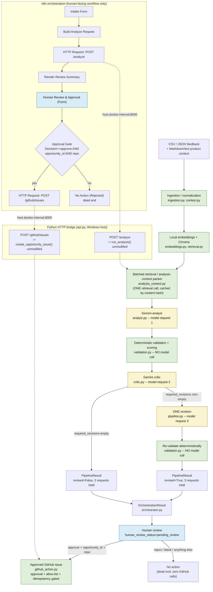

# Architecture

This diagram shows the actual, implemented pipeline -- not an aspirational
version of it. Every box corresponds to a real module or n8n node named
below it.

## Deterministic vs. model-controlled components

| Component | Deterministic (code) | Model-controlled (Gemini) |
|---|---|---|
| Ingestion / normalization | Yes | -- |
| Embeddings + Chroma retrieval | Yes | -- |
| Analysis-context packet (stats, diversity sampling, cache key) | Yes | -- |
| Opportunity drafting | -- | Yes (analyst, request 1) |
| Citation/quote/segment validation, `evidence_count`, score | Yes | -- |
| Reasoning-quality review (`required_revisions`) | -- | Yes (critic, request 2) |
| `PASS`/`REVISE` status | Yes (`derive_critic_status`, from `required_revisions`) | -- |
| One bounded revision draft | -- | Yes (revision, request 3, conditional) |
| Re-validation after revision | Yes | -- |
| GitHub issue payload rendering | Yes | -- |
| Approval / allow-list / idempotency decision | Yes (code) + human (the approval itself) | -- |

## Request ceiling

Every run makes **exactly 2** model requests (analyst + critic, critic
returns no required revisions) **or exactly 3** (analyst + critic + one
revision). There is no loop anywhere in `pipeline.py`, and no code path can
reach a 4th request -- this is proven by `tests/test_pipeline.py` and
`eval/cases.py` (R9/R10), not just documented.

## n8n orchestration and the Python HTTP bridge

n8n owns only the human-facing workflow: an intake form, a review/approval
form, and branching on the approval decision. It contains no retrieval,
analyst/critic/revision, validation, scoring, or GitHub-mutation logic of
its own -- both "HTTP Request" nodes call a small local Starlette+uvicorn
service (`src/product_feedback_agent/api.py`) running on the Windows host,
which itself only forwards, unmodified, to `orchestrator.run_analysis` and
`github_action.create_opportunity_issue`. Docker Desktop's n8n container
reaches that service at `host.docker.internal:8000`. See
`docs/n8n-setup.md` for the full setup guide and
`docs/results-log.md` ("Live Stage 15 Success") for the live end-to-end
validation of this exact path, including the reject path making zero
GitHub calls and the approve path creating one real GitHub issue.

## Why the request ceiling and the human-approval boundary are both load-bearing

The two together are what make this safe to demo against a real GitHub
repository and a metered Gemini quota at the same time: the request ceiling
bounds cost and API usage per run regardless of how the critic responds,
and the approval boundary means a bug, a bad model response, or a
misconfigured workflow can produce a wrong *recommendation* but never a
silent, unapproved external mutation.
