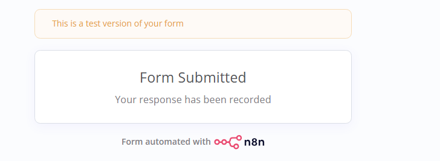
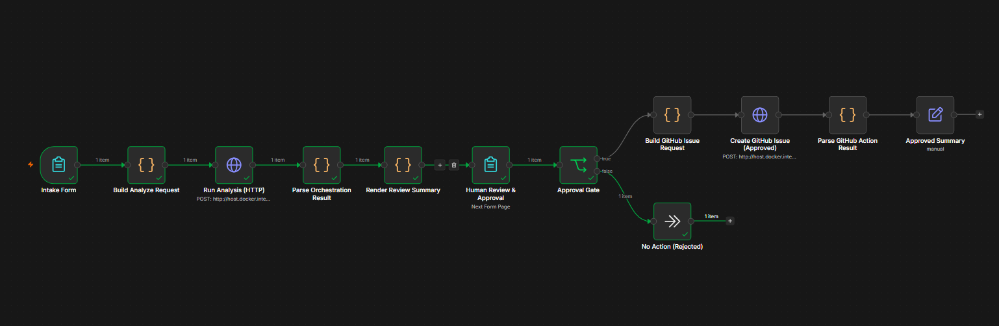
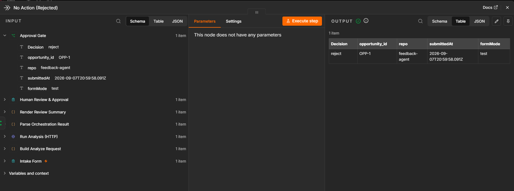
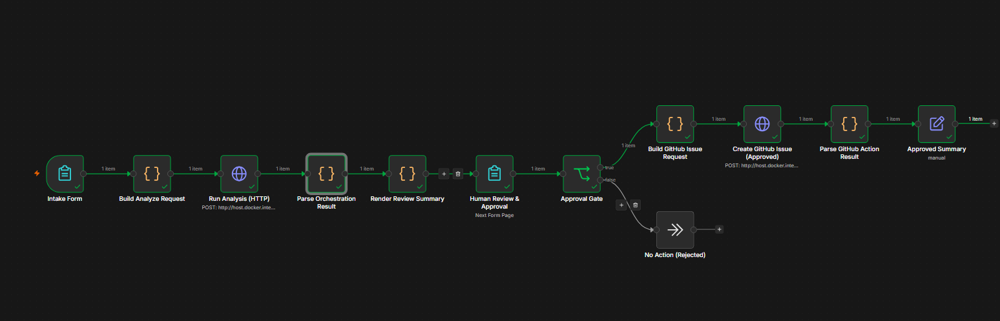

# Demo Script

A concise, portfolio-appropriate walkthrough. Everything below reflects
something actually implemented and, where marked **(live)**, actually run
against a real n8n instance, real Gemini calls, and a real GitHub repo (see
`docs/results-log.md`, "Live Stage 15 Success", for the exact trace-log
evidence). Nothing below is aspirational.

## 1. The problem (30 seconds)

"Product teams have more customer feedback than time to synthesize it, and
turning it into a defensible short list of opportunities is slow and easy
to get wrong. Product Feedback Agent takes raw feedback + optional
strategy/roadmap docs and produces exactly three evidence-backed
opportunities -- reviewed by a second AI pass, and gated behind a human
before anything external happens."

## 2. The input (30 seconds)

Show `data/samples/feedback_sample.csv` (raw customer feedback: support
tickets, app-store reviews, survey responses) and
`data/samples/roadmap.md` / `product_strategy.md` (optional product
context). Point out: mixed sources, missing IDs, a duplicate row, one blank
row -- ingestion handles all of this deterministically
(`tests/test_ingestion.py`).

## 3. Run the workflow **(live)**

Open the n8n **Intake Form**, submit the sample feedback/context paths and
a query (e.g. "search result filtering friction"). This calls
`POST /analyze` on the local Python HTTP service, which runs the full
Group 1 pipeline (ingestion -> retrieval -> analyst -> validator -> critic
-> optional revision) unmodified.

## 4. Show exactly 3 grounded opportunities

The **Render Review Summary** node (or the raw JSON, if demoing via `curl`/
the CLI) shows exactly 3 opportunity cards -- never more, never fewer; this
is enforced at the schema level (`AnalystOutput.opportunities`,
`min_length=3, max_length=3`), not just by convention.

## 5. Evidence / citations

For one opportunity, point out: the exact quoted excerpt (verbatim
substring of the cited feedback text), the `feedback_id` it's cited from,
and (if present) a related product-context section citation. Mention: every
one of these is checked in code against the same evidence packet
(`validation.py`) -- an invented ID or a paraphrased "quote" is rejected,
not silently accepted.

## 6. Deterministic scores

Show one opportunity's score breakdown (evidence strength, severity,
strategic alignment, segment breadth, confidence, and the weighted total).
Mention the formula is fixed and published (`docs/decisions.md`,
`compute_score`), and that `roadmap_status` is deliberately excluded from
scoring -- it's shown as context, not folded into the number.

## 7. Critic / revision

Mention: a second Gemini pass reviews the draft's reasoning quality (not
just citation validity) and returns `required_revisions` -- if non-empty,
exactly one revision is made and re-validated; the critic is never called
twice. Point to the measured request counts:
`model_request_count == 2` (pass) or `== 3` (one revision) -- **never 4**.

## 8. Human review

Open **Human Review & Approval**. Emphasize: nothing external has happened
yet. `OrchestrationResult` has no "approved" field and no issue URL --
there is no code path that can mark this as decided without a human.



*The confirmation screen a human sees after submitting their review
decision -- direct evidence this step is a real, submittable form, not a
simulated one.*

## 9. Reject safety **(live)**

Submit `Decision = reject`. Show the run dead-ending at **No Action
(Rejected)** with zero GitHub calls -- live-confirmed: no
`github_action` trace entry appears for this submission (see
`docs/results-log.md`).



*Every node up through `Approval Gate` completed; the entire
GitHub-issue branch (`Build GitHub Issue Request` onward) never ran.*



*The rejected node's own input data, confirming `Decision: reject` is what
reached it.*

## 10. Approved GitHub issue **(live)**

Submit `Decision = approve` with a real `opportunity_id` and a disposable
demo repo. Show the resulting real GitHub issue:
`datascout0/product-feedback-agent` issue #1, "[Opportunity] Search Result
Filtering Friction" -- created via `POST /github/issues`, gated by the
allow-list/approval/idempotency checks in `github_action.py`. Mention:
re-submitting the same approval again would be refused as a duplicate, not
filed twice.



*The run that created issue #1: every node, including `Create GitHub Issue
(Approved)` and `Approved Summary`, completed. See `docs/screenshots.md`
for why the issue itself isn't screenshotted (it's already documented as
text, corroborated by the real GitHub API trace log).*

## 11. Evaluation evidence

Run (or show the committed output of):

```
.\.venv\Scripts\python.exe -m eval.run_evaluation
```

Point at the measured numbers: 34/34 cases passed, 10/10 grounding checks,
19/19 expected validation violations caught, 9/9 safety cases -- all
computed by actually running the cases against the real production code,
nothing estimated (`eval/evaluation_report.md`).

## 12. Secondary-domain reuse

Mention: the same architecture was run, unmodified, against a synthetic
customer-onboarding/support dataset (`data/samples/secondary_domain/`,
`tests/test_secondary_domain.py`) -- same schemas, same validator, same
scoring formula, same critic contract, same human-approval model. Only the
data and context changed. A static check confirms none of the ten core
pipeline modules mention onboarding/SSO-specific terms.

## 13. Limitations (be direct)

- Solo MVP, small sample datasets, no auth on the local HTTP service.
- No Recall@k-style retrieval evaluation against a large labelled gold set.
- The critic's judgment quality isn't independently graded -- only its
  structural contract and the deterministic checks under it are.
- Gemini API quotas on a free-tier project are restrictive; a configurable
  model override (`PFA_GEMINI_MODEL`) exists to keep testing moving when
  hit.

Full list: `README.md` section 18.
