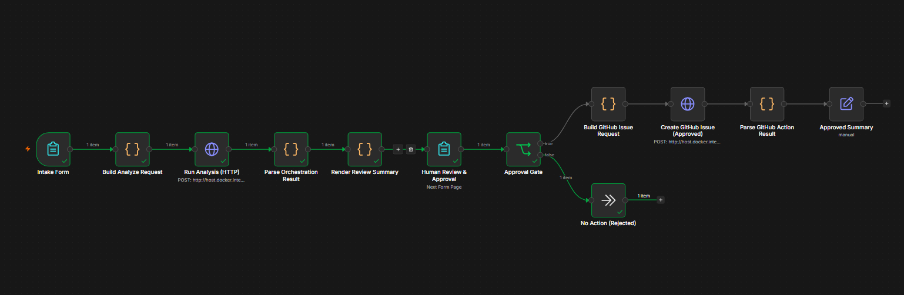
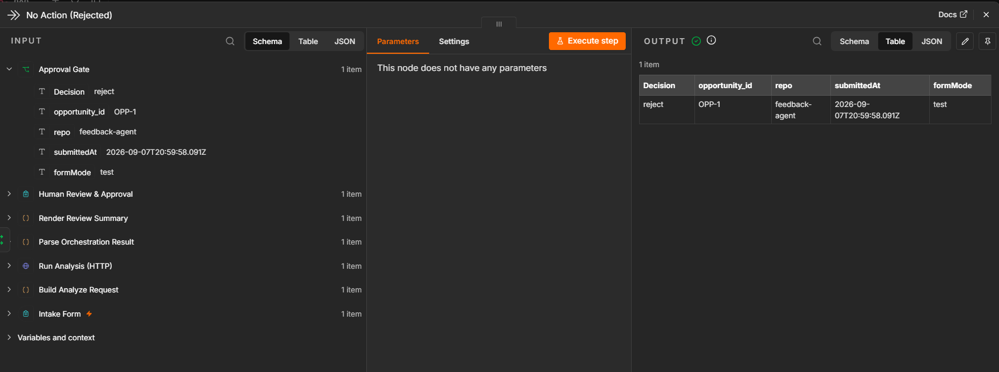
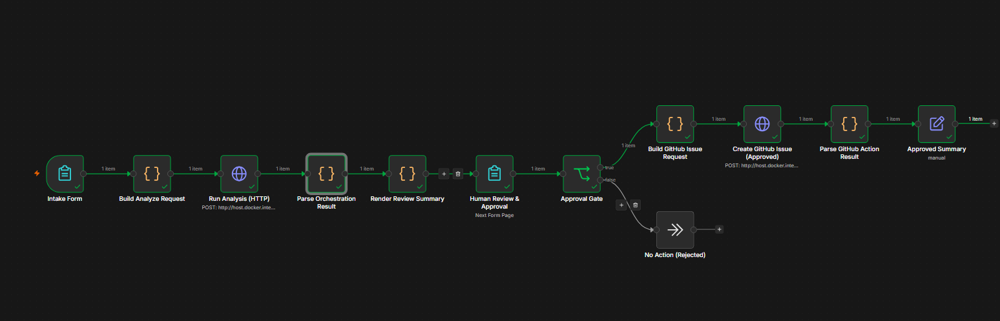
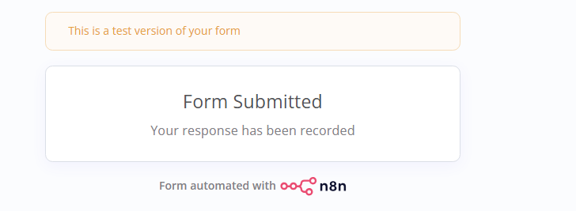

# Screenshot / Evidence Plan

This identifies which parts of the demo are worth a screenshot for a
portfolio/demo, and which are already better evidenced by committed,
source-controlled test/evaluation output. Every image embedded below is a
real screenshot committed under `docs/screenshots/` from the actual live
n8n run recorded in `docs/results-log.md` ("Live Stage 15 Success") -- none
of it is a mockup or a fabricated rendering.

## Captured

### 1. Reject path makes zero GitHub calls

*The executed run graph for a `Decision = reject` submission. Every node up
through `Approval Gate` completed (green check), the gate's `false` branch
reached `No Action (Rejected)`, and the entire approve-only branch --
`Build GitHub Issue Request`, `Create GitHub Issue (Approved)`, `Parse
GitHub Action Result`, `Approved Summary` -- never executed at all. This is
the visual confirmation that a reject decision cannot reach a GitHub
mutation, matching the trace-log evidence (no `github_action` log entry for
this run) recorded in `docs/results-log.md`.*

*The `No Action (Rejected)` node's own input data, confirming exactly what
reached the dead end: `Decision: reject`, plus the submitted
`opportunity_id`/`repo`/`submittedAt`. The Approval Gate routes on
`Decision` alone (case-sensitive `"approve"` required) -- a non-approve
decision dead-ends regardless of what `opportunity_id`/`repo` were typed,
which is why this test run's values differ from the real approved run's.*

### 2. Approve path reaches the GitHub action and Approved Summary

*The executed run graph for a `Decision = approve` submission. Every node
is green/checked, including the approve-only branch: `Build GitHub Issue
Request` -> `Create GitHub Issue (Approved)` (the live `POST
/github/issues` call) -> `Parse GitHub Action Result` -> `Approved Summary`.
This is the run that created the real GitHub issue documented in
`docs/results-log.md` ("Live Stage 15 Success") and
`docs/agent-progress.md`: `datascout0/product-feedback-agent` issue #1,
"[Opportunity] Search Result Filtering Friction".*

### 3. Human-in-the-loop form evidence

*The n8n Form node's confirmation screen after a human submits their
review decision. This is generic (it doesn't show which decision was
submitted, or the rendered opportunity summary that preceded it), but it is
direct evidence that the human-review step in this workflow is a real,
submittable form a person interacts with -- not a placeholder or a
simulated step.*

## Deliberately not captured

- **The real created GitHub issue.** Issue #1
  (`datascout0/product-feedback-agent`, "[Opportunity] Search Result
  Filtering Friction") is documented as text in `docs/results-log.md` and
  `docs/agent-progress.md`, corroborated by the `find`/`create` entries in
  `logs/github-actions.jsonl`. No screenshot of it is included here --
  adding one now, after the fact, from memory or a mockup would not be
  genuine evidence, so it is intentionally left as a documented fact rather
  than fabricated as an image.
- **The human approval form mid-fill** (showing the rendered opportunity
  summary alongside the `Decision`/`opportunity_id`/`repo` fields before
  submission). Only the post-submission confirmation screen was captured;
  the mid-fill view was not, and is not fabricated here either.

## Not worth a screenshot (better shown as committed output)

- **Exactly 3 opportunities / schema enforcement** -- shown far more
  convincingly by `AnalystOutput`'s `min_length=3, max_length=3` and the
  passing `eval/cases.py` R1a/R1b/R1c cases than by a screenshot of a form.
- **Citation/quote/segment grounding** -- `eval/evaluation_report.md`'s
  per-case detail (R3-R5, R16, R17) is a more precise, reproducible record
  than a screenshot of one example.
- **Deterministic scoring** -- the formula and its boundary tests
  (`tests/test_validation.py`, `eval/cases.py` R7) are exact; a screenshot
  of one computed number adds nothing a reader can verify.
- **The 2-request / 3-request model budget** -- proven by
  `tests/test_pipeline.py` and `eval/cases.py` R9/R10, and by the real
  trace-log entries quoted in `docs/results-log.md` (timestamps, durations,
  token counts) -- more precise than a screenshot of a log line.
- **Secondary-domain reuse** -- `tests/test_secondary_domain.py`'s passing
  output and the "no domain-specific branch" static check are the actual
  evidence; a screenshot of a second CSV file proves nothing by itself.
- **Full pytest suite result** -- a terminal screenshot of `pytest -q` is
  strictly less useful than the actual command in
  `docs/results-log.md`/`docs/agent-progress.md`, which a reader can
  re-run themselves.

## Principle

A screenshot earns its place only where the UI *is* the evidence (a human
decision happening, or an external system's own rendering of something this
project created). Everywhere the evidence is a deterministic, re-runnable
check, the committed test/evaluation output is the stronger artifact --
duplicating it as a screenshot would only make it staler and harder to
verify.
